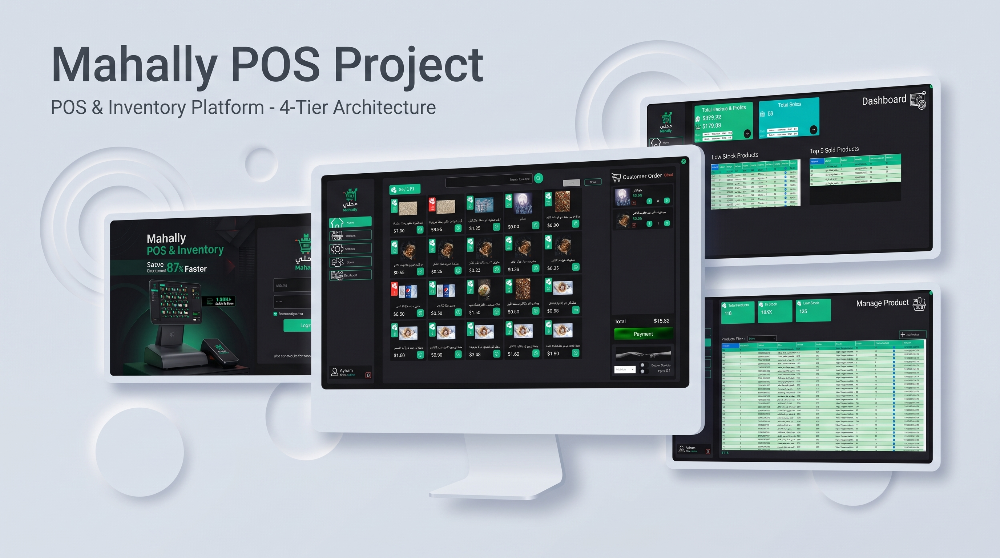

# 🛒 Mahally POS — Point of Sale & Inventory Management System



**Mahally POS** is a desktop Point of Sale and Inventory Management system built using **C# (.NET WinForms)** and **SQL Server**. Designed with a **4-Tier Architecture** (UI, BLL, DAL, DTOs) and **Stored Procedures**, it provides a fast checkout workflow, real-time stock tracking, and financial analytics for retail stores.

---

## ✨ Key Features

* **⚡ Fast POS & Checkout:** Barcode scanner support, instant cart calculation, and smooth receipt generation.
* **📦 Inventory Management:** Track stock levels in real time with automatic **Low Stock Alerts** when products hit minimum thresholds.
* **📊 Financial Dashboard:** Track **Total Income**, **Net Profit**, total sales count, and **Top 5 Best-Selling Products** within custom date ranges.
* **🔐 Role-Based Security:** Separate permissions for **Admin** and **Cashier** accounts, protected with **SHA-256** password hashing.
* **🛡️ Soft Delete Architecture:** Uses `IsActive` flags instead of hard deletes to preserve historical invoices, sales reports, and audit logs.
* **⚙️ Async Database Operations:** Built with `async/await` in ADO.NET to keep the UI responsive during database queries.

---

## 🏗️ System Architecture

The solution follows a clean **4-Tier Architecture** for separation of concerns and maintainability:

1. **Presentation Layer (`Mini_POS`):** Windows Forms UI styled with Guna UI2.
2. **Business Logic Layer (`BLL`):** Validation rules, password hashing, and business workflows.
3. **Data Access Layer (`DAL`):** Asynchronous ADO.NET operations calling SQL Server Stored Procedures.
4. **Data Transfer Objects (`DTO`):** Lightweight models carrying data across layers.

---

## 🛠️ Tech Stack

* **Language & Framework:** C#, .NET Framework (Windows Forms)
* **UI Library:** Guna UI2
* **Database:** Microsoft SQL Server (T-SQL, Stored Procedures)
* **Data Access:** ADO.NET (`SqlConnection`, `SqlCommand`, `SqlDataReader`)

---

## 🚀 Getting Started

### 1. Database Setup
Download the SQL Server database backup file and restore it in **SQL Server Management Studio (SSMS)**:

👉 **[⬇️ Download Database Backup (`MahallyPOS.bak`)](assets/MahallyPOS.bak)**

1. Open **SSMS** and connect to your local SQL Server instance.
2. Right-click **Databases** → **Restore Database...**
3. Select **Device** → Browse and pick `MahallyPOS.bak`.
4. Click **OK** to restore the database.

### 2. Configure Connection String
Open `dalSettings.cs` inside the **DAL** project and update the connection string to match your SQL Server name:

```csharp
public static string ConnectionString = "Server=YOUR_SERVER_NAME;Database=MahallyPOS;User Id=ID; Password=PASSWORD;";
